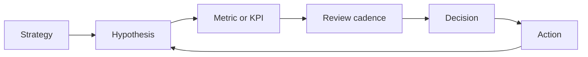
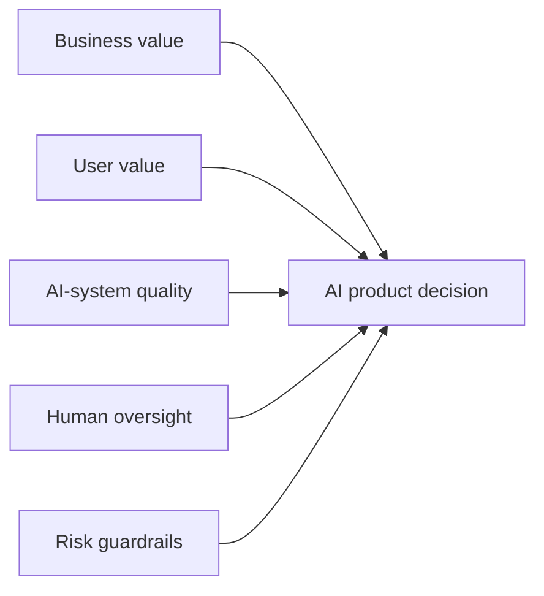
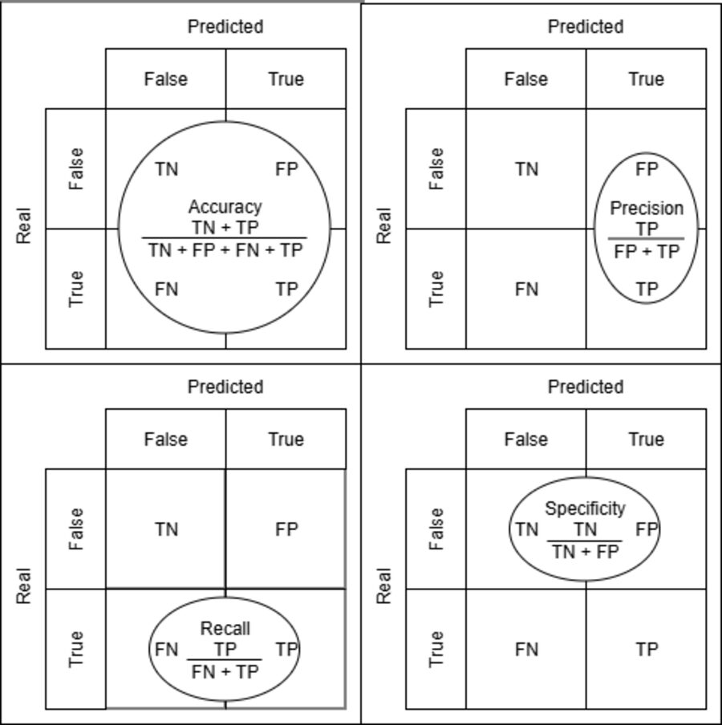
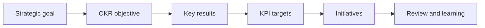

# Measurement Foundations

## Learning Objectives

By the end of this lesson, you should be able to:

- distinguish metrics, KPIs, OKRs, targets, and initiatives;
- explain why measurement starts with a decision question;
- separate activity, output, outcome, and impact measures;
- identify leading, lagging, proxy, and counter-metrics;
- distinguish business, user, AI-system, human-oversight, and risk metrics;
- describe the risks of measuring what is easy rather than what matters.

## Why Measurement Exists

Measurement is not reporting for its own sake. In product management,
measurement exists to help teams make decisions under uncertainty.

A useful measurement system answers questions such as:

- Are we solving the problem we intended to solve?
- Is the product changing user behavior in the desired way?
- Is the AI system accurate, reliable, explainable enough, and useful in the
  real workflow?
- Is the business model improving without damaging trust, quality, or fairness?
- Should we continue, change direction, pause, or stop?

If a metric does not inform a decision, it may still be interesting, but it is
not yet a management tool.

## Metrics, KPIs, OKRs, and Initiatives

These terms are often mixed together. Keep them separate.

| Term | Meaning | Example |
| --- | --- | --- |
| Metric | Any quantitative measure | Number of profile views |
| KPI | A key metric tied to a strategic goal and target | Agent contact-lead conversion rate reaches 6% by quarter end |
| Target | The desired value, threshold, or range | At least 6%, no more than 2% complaint rate |
| OKR | A goal-setting structure with an objective and measurable key results | Improve agent acquisition quality with three measurable outcomes |
| Initiative | Work done to influence the metric or OKR | Add ranking rules, redesign widget, run onboarding campaign |

A KPI tells the team whether an important result is on track. An OKR describes
what the team is trying to achieve and how achievement will be judged.
Initiatives are bets; they are not results.

## The AI Product Measurement Stack

AI products need more than a single business KPI. A useful measurement system
connects product value to model behavior, human oversight, and risk controls.

| Layer | Question | Example metric |
| --- | --- | --- |
| Business value | Does the product improve the business model? | Paid-agent retention |
| User value | Does the product improve the user or customer workflow? | Qualified contact leads per participating agent |
| AI-system quality | Does the model or algorithm perform well enough? | Relevant recommendation rate or allocation accuracy |
| Human oversight | Can people review, override, or recover from errors? | Override rate, escalation rate, review time |
| Risk guardrails | Are trust, fairness, privacy, and cost controlled? | Complaint rate, segment disparity, policy exceptions |

For Imageboost, the "AI" component may be simple at first: a random or
algorithmic allocation decides which agent appears. Even simple allocation
logic needs measurement. If the product later uses ranking, personalization, or
lead-quality prediction, the AI-system layer becomes more important.

## Activity, Output, Outcome, and Impact

Product teams often measure the work because it is visible. Strategy usually
depends on outcomes and impact.

| Layer | Question | Example |
| --- | --- | --- |
| Activity | What did we do? | Ran five agent interviews |
| Output | What did we ship? | Launched Imageboost widget |
| Outcome | What changed for users or customers? | Agents received more qualified contact leads |
| Impact | What changed for the business or mission? | Paid agent retention improved |

Activity and output measures help manage delivery. Outcome and impact measures
help manage value. A complete dashboard may need both, but KPIs should focus on
the few measures that shape important decisions.

## Leading, Lagging, Proxy, and Counter-Metrics

Not every useful metric behaves the same way.

| Metric type | Purpose | Example |
| --- | --- | --- |
| Leading indicator | Gives early signal before the final outcome is known | Widget click-through rate |
| Lagging indicator | Confirms the final result after delay | Monthly paid-agent retention |
| Proxy metric | Estimates something hard to observe directly | Profile views as a proxy for agent visibility |
| Counter-metric | Protects against harmful optimization | Complaint rate, unsubscribe rate, support tickets |

In AI products, counter-metrics are especially important. Improving one number
can quietly harm trust, fairness, quality, privacy, or cost.

## AI-System Metrics

AI-system metrics depend on the type of system. They should not replace product
KPIs, but they explain whether the AI part is working well enough to support
the product outcome.

| AI capability | Useful metric examples |
| --- | --- |
| Ranking or recommendation | Relevance rating, click-through rate, qualified conversion by rank |
| Classification | Precision, recall, false positive rate, false negative rate |
| Generation | Groundedness, hallucination rate, policy violation rate, human rating |
| Automation | Automation success rate, escalation rate, human override rate |
| Allocation | Exposure distribution, segment fairness, quality-weighted allocation |
| Operations | Latency, uptime, cost per request, data freshness |

_Source: Wikimedia Commons, ["Confusion Matrix Metrics.png"][confusion-matrix]
by Hssiqueira, CC0._

For an AI project manager, the key question is not "Which model metric is most
famous?" but "Which model metric explains whether the product can be trusted in
this workflow?"

## KPI and OKR Relationship

KPIs and OKRs are complementary, not rivals.

For example:

- Strategic goal: grow the paid agent business.
- Objective: make Imageboost a trusted acquisition channel for agents.
- Key result: increase qualified agent contact leads from Imageboost.
- KPI: qualified contact-lead conversion rate.
- Initiative: improve widget placement, creative copy, and lead-routing rules.

## Metric Failure Patterns

Common failure patterns include:

| Failure pattern | What happens | Better move |
| --- | --- | --- |
| Vanity metric | The number looks good but does not inform a decision | Link the metric to a decision and target |
| Metric overload | Too many measures create noise | Separate dashboard metrics from KPIs |
| Missing denominator | Counts grow because volume grows | Use rates, ratios, or segment-normalized measures |
| Weak proxy | The metric is easy to collect but far from value | Name the assumption and validate it |
| No counter-metric | Optimization creates side effects | Pair success metrics with guardrails |
| Model-only reporting | Model quality looks good but business or user value is unknown | Connect AI-system metrics to product outcomes |
| Average-only reporting | Overall performance hides weak segments | Review relevant user, customer, or market segments |
| No owner | Nobody reacts when the metric moves | Assign review owner and decision cadence |

## Check Your Understanding

### Question 1

Why is "number of dashboard views" usually not enough as a KPI?

Show solution

It is usually an activity or usage metric. It may be useful, but it does not
prove whether users made better decisions, whether the product created
business value, or what action the team should take.

### Question 2

What is the difference between a KPI and an initiative?

Show solution

A KPI measures progress toward an important result. An initiative is work the
team performs to influence that result. "Increase qualified lead conversion" is
a KPI direction; "redesign the contact button" is an initiative.

### Question 3

Why should AI product teams define counter-metrics?

Show solution

AI products can optimize one measurable goal while harming trust, fairness,
privacy, reliability, or cost. Counter-metrics make these trade-offs visible
before the team over-optimizes the primary metric.

### Question 4

Why is model accuracy alone not enough to measure an AI product?

Show solution

Model accuracy may show that one technical component performs well on a test
set, but it does not prove user value, business impact, fairness across
segments, operational reliability, or safe human oversight. AI products need a
measurement stack that connects model quality to real-world decisions.

## Key Takeaways

- Measurement starts with decisions, not dashboards.
- KPIs are a small set of strategically important metrics with targets and
  ownership.
- OKRs connect ambition to measurable outcomes.
- Initiatives are the work, not the result.
- AI product measurement should cover business value, user value, AI-system
  quality, human oversight, and risk guardrails.
- Every important metric needs a definition, owner, cadence, and counter-metric.

## Further Reading

- [KPI.org: KPI Basics](https://www.kpi.org/kpi-basics/)
- [KPI.org: KPI Development](https://www.kpi.org/kpi-basics/kpi-development/)
- [NIST AI Risk Management Framework](https://www.nist.gov/itl/ai-risk-management-framework)
- [SMART criteria](https://en.wikipedia.org/wiki/SMART_criteria)
- [Wikimedia Commons: Confusion Matrix
  Metrics](https://commons.wikimedia.org/wiki/File:Confusion_Matrix_Metrics.png)

[confusion-matrix]: https://commons.wikimedia.org/wiki/File:Confusion_Matrix_Metrics.png
