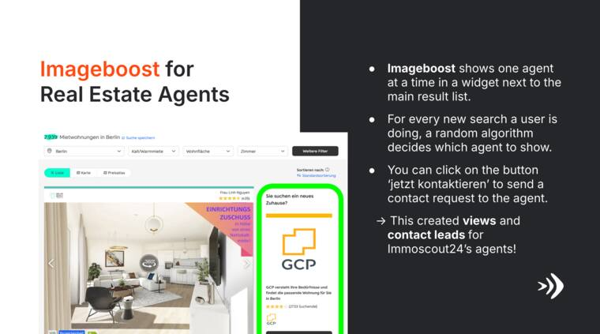

# KPI Design

## Learning Objectives

By the end of this lesson, you should be able to:

- turn a business goal into measurable product hypotheses;
- write a KPI definition that another team can reproduce;
- choose useful segments, baselines, targets, and review cadences;
- use SMART criteria without creating artificial precision;
- design KPI sets that combine business, user, AI-system, and risk measures;
- identify counter-metrics for AI product decisions.

## Start with the Decision Question

Good KPI design begins before choosing a number.

Ask:

1. What business or user outcome do we want to improve?
2. What decision will this measurement support?
3. What behavior should change if the KPI moves?
4. What data can we observe reliably?
5. Which AI-system behavior explains or constrains the product outcome?
6. What failure modes must we guard against?

For the Imageboost scenario, the decision question might be:

> Should ImmoScout24 invest further in Imageboost as a paid agent-growth
> product?

That question immediately suggests outcome, quality, and risk measures.

For AI products, the next question is:

> Which AI-system behavior must be reliable for that business outcome to be
> credible?

## The Imageboost Product Context

Imageboost is a promoted agent-profile widget placed next to the main property
search results. The widget displays one real estate agent at a time and gives
visitors a direct contact button.

_Source: local course export, Imageboost case screenshot._

The product is expected to create two important outcomes for agents:

- more profile visibility;
- more contact leads from potential clients.

If the allocation logic later becomes ranking or personalization, the product
team must also measure whether the system shows relevant agents, distributes
exposure fairly enough, and avoids creating low-quality or unwanted contacts.

_Source: local course export, Imageboost case screenshot._

## KPI Candidate Funnel

For Imageboost, a first metric funnel could look like this:

Each step has a possible KPI, but not every metric should become a KPI. KPIs
should be the few measures that show whether the product is creating meaningful
value.

## Business, User, AI-System, and Risk KPIs

For AI product management, avoid choosing only business metrics or only model
metrics. The KPI set should explain value and control risk.

| Layer | Example KPI or guardrail | Why it matters |
| --- | --- | --- |
| Business | Paid-agent retention or upgrade rate | Shows whether Imageboost supports the revenue model |
| User or customer | Qualified contact-lead conversion rate | Shows whether agents receive useful opportunities |
| AI-system quality | Relevant-agent display rate or quality-weighted allocation | Shows whether allocation or ranking supports the desired outcome |
| Human oversight | Manual review or override rate for questionable leads | Shows whether people can correct system behavior |
| Risk guardrail | Complaint rate, duplicate lead rate, exposure concentration | Shows whether optimization creates harm or unfairness |

This structure keeps the conversation honest. A model can appear strong while
the product fails commercially. A business KPI can improve while the system
creates trust, fairness, or quality problems.

## KPI Definition Template

Use a definition table before presenting any KPI.

| Field | Question to answer |
| --- | --- |
| KPI name | What is the metric called? |
| Strategic goal | Which business or product goal does it support? |
| Definition | Exactly what is counted or calculated? |
| Formula | How is the value computed? |
| Unit | Count, percentage, currency, time, score, or ratio? |
| Population | Which users, customers, listings, or sessions are included? |
| Exclusions | What is intentionally left out? |
| Segment | Which breakdowns are decision-relevant? |
| AI-system behavior | Which model, ranking, allocation, or automation behavior affects this KPI? |
| Baseline | What is the current value or reference period? |
| Target | What value or range indicates success? |
| Cadence | How often is it reviewed? |
| Owner | Who reacts when it moves? |
| Counter-metric | What harm or side effect must stay controlled? |

## Example KPI Definitions

| KPI | Definition | Target | Counter-metric |
| --- | --- | --- | --- |
| Qualified lead conversion rate | Qualified Imageboost leads divided by Imageboost widget impressions | Increase from baseline by an agreed percentage within the pilot period | Complaint rate from consumers and agents |
| Agent profile visibility | Average profile views per participating agent per week | Improve without concentrating exposure among a few agents | Exposure fairness across participating agents |
| Relevant-agent display rate | Share of impressions where the displayed agent matches the search context and market | Reach agreed relevance threshold before broader rollout | Exposure concentration and complaints |
| Contact lead quality | Share of submitted leads accepted as useful by agents | Reach agreed quality threshold | Lead volume must not collapse |
| Paid-agent retention risk | Churn rate among participating agents | No increase versus comparable non-participants | Support-ticket volume |

Notice that the target examples still need a baseline. A target without a
baseline is usually an aspiration, not a management commitment.

## SMART Targets

SMART helps turn vague goals into testable targets.

| SMART element | KPI design question |
| --- | --- |
| Specific | What exactly changes, for whom, and in which context? |
| Measurable | Can the metric be computed consistently from available data? |
| Achievable | Is the target plausible given baseline, resources, and constraints? |
| Relevant | Does the KPI connect to strategy and decision-making? |
| Time-bound | By when will the result be reviewed? |

Weak target:

> Improve Imageboost performance.

Stronger target:

> Increase qualified Imageboost contact-lead conversion rate for participating
> Berlin rental agents by 15% versus baseline within the pilot period, while
> keeping consumer complaint rate below the agreed threshold.

## Segmentation and Denominators

A metric often becomes useful only after segmentation.

Relevant Imageboost segments might include:

- agent type: agency, private landlord, premium account;
- geography: city, region, urban versus rural;
- search intent: rent, buy, commercial;
- placement: top, middle, bottom, mobile, desktop;
- lead type: call, message, saved profile, form submission.
- algorithm version: random allocation, rule-based ranking, personalized
  ranking, or lead-quality model;
- protected or sensitive-adjacent business concerns where appropriate:
  geography, agent size, market maturity, and exposure concentration.

Always ask what the denominator is. "Leads increased" means little without
knowing whether impressions, traffic, or participating agents also changed.

## AI Metric Quality Questions

Before using an AI-system metric in a KPI set, ask:

| Question | Why it matters |
| --- | --- |
| What is the ground truth or judgment source? | Many AI quality metrics depend on labels, human ratings, or delayed outcomes |
| Which segment could be harmed by average performance? | Overall quality may hide weak performance for smaller markets or agent types |
| Is the metric online, offline, or human-reviewed? | Offline performance may not match production behavior |
| How quickly can the metric drift? | Data, market behavior, and model behavior can change after launch |
| What decision follows a bad value? | A metric without a response plan is dashboard decoration |

## Check Your Understanding

### Question 1

Why is "number of Imageboost leads" weaker than "qualified lead conversion
rate"?

Show solution

Lead count can increase simply because impressions increased. A conversion rate
connects the outcome to the exposure base. A qualified conversion rate also
protects against low-quality leads.

### Question 2

What makes a counter-metric different from a secondary KPI?

Show solution

A counter-metric is designed to prevent harmful optimization. It may not be the
main success measure, but it defines boundaries the team should not cross while
improving the primary KPI.

### Question 3

Why should KPI definitions include exclusions?

Show solution

Exclusions prevent silent changes in interpretation. For example, test users,
duplicate leads, spam leads, internal traffic, or incomplete sessions may need
to be excluded so teams compare the same thing over time.

### Question 4

Why should an Imageboost KPI set include both lead conversion and exposure
fairness?

Show solution

Lead conversion measures value, but exposure fairness checks whether the
allocation or ranking system concentrates opportunity too heavily among a small
set of agents. Without the guardrail, the product might improve the average
while creating an unacceptable distribution problem.

## Key Takeaways

- A KPI is only useful when it supports a decision.
- A strong KPI definition includes formula, population, exclusions, cadence,
  owner, and counter-metric.
- SMART targets need baselines and timeframes.
- Segmenting by customer, channel, geography, or device often reveals the real
  product story.
- AI-product KPI sets should connect business value, user value, AI-system
  behavior, human oversight, and risk guardrails.

## Further Reading

- [KPI.org: KPI Basics](https://www.kpi.org/kpi-basics/)
- [KPI.org: KPI Development](https://www.kpi.org/kpi-basics/kpi-development/)
- [NIST AI Risk Management Framework](https://www.nist.gov/itl/ai-risk-management-framework)
- [SMART criteria](https://en.wikipedia.org/wiki/SMART_criteria)
