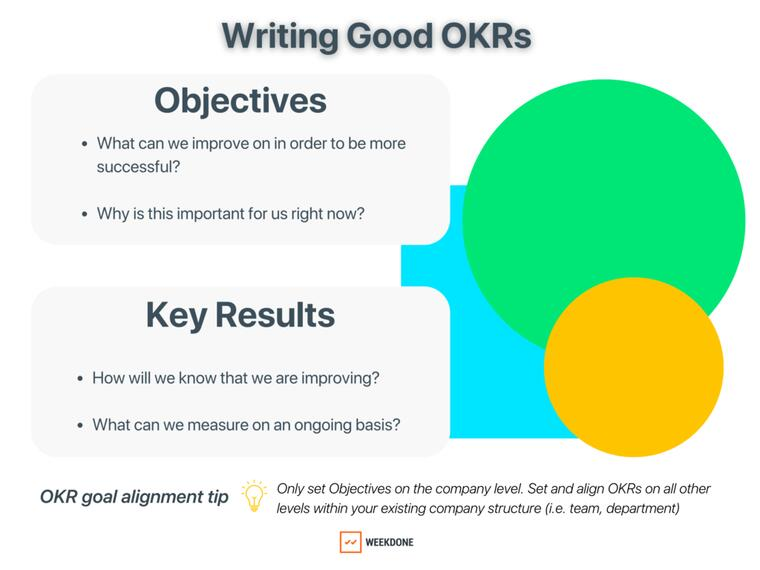
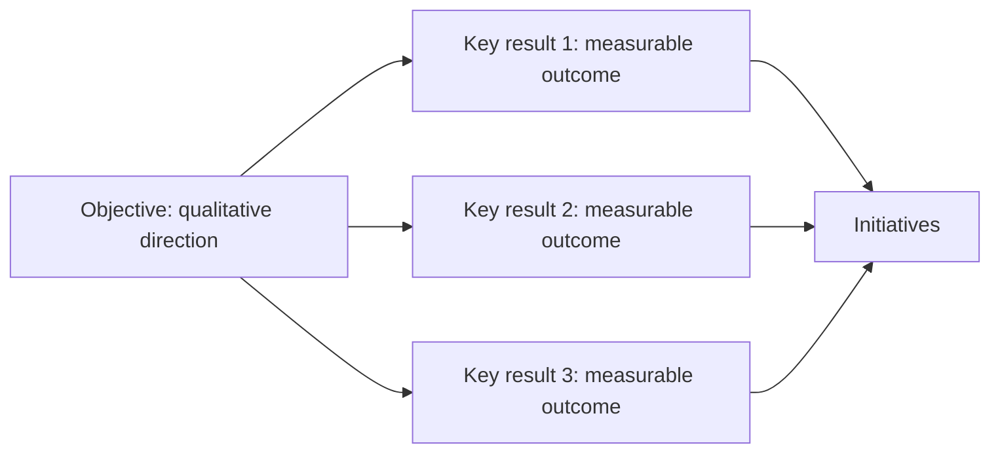

# OKR Design and Alignment

## Learning Objectives

By the end of this lesson, you should be able to:

- explain the structure and purpose of OKRs;
- distinguish objectives, key results, KPIs, and initiatives;
- write outcome-oriented key results;
- align team OKRs with product and business strategy;
- include AI-system quality and guardrails in OKRs when they are central to
  product success;
- use AI to critique OKRs without letting it invent strategic priorities.

## What OKRs Are For

OKR stands for Objectives and Key Results. OKRs help teams align around a small
number of important outcomes.

- The **objective** describes what the team wants to achieve.
- The **key results** describe how the team will know whether the objective was
  achieved.
- The **initiatives** describe the work the team will try in order to influence
  the key results.

Google re:Work describes OKRs as a way to set and communicate goals and track
progress. What Matters describes them as a collaborative goal-setting method
for ambitious goals with measurable results.



_Source: Weekdone, "Writing Good OKRs" image from the local course export._

## OKR Anatomy



An objective should be memorable and directional. Key results should be
measurable and hard to misinterpret. Initiatives should stay separate so the
team does not confuse shipping work with achieving value.

## OKRs, KPIs, and Initiatives

| Concept | Good example | Weak example |
| --- | --- | --- |
| Objective | Make Imageboost a trusted growth channel for agents | Launch Imageboost |
| Key result | Increase qualified lead conversion versus baseline while keeping complaints controlled | Redesign the widget |
| KPI | Qualified lead conversion rate | Number of meetings about Imageboost |
| Initiative | Test new widget copy for premium agents | Improve awareness |

The weak examples are not always useless. They may be tasks, activities, or
themes. They are weak OKR components because they do not define a measurable
outcome.

## OKRs for AI Products

AI-product OKRs should avoid two extremes:

- only measuring business outcomes, while ignoring whether the AI system is
  trustworthy, fair, reliable, and usable;
- only measuring model performance, while ignoring whether the product creates
  customer and business value.

A balanced AI-product OKR usually combines:

| Key result type | Purpose | Example |
| --- | --- | --- |
| Business outcome | Prove the product creates strategic value | Improve paid-agent retention among participants |
| User or customer outcome | Prove the workflow improves | Increase qualified contact-lead conversion |
| AI-system quality | Prove the model or algorithm is good enough | Reach relevance threshold for displayed agents |
| Guardrail | Prevent unacceptable side effects | Keep complaint rate and exposure concentration below threshold |

## Example Imageboost OKR

Objective:

> Make Imageboost a trusted acquisition channel for real estate agents.

Key results:

1. Increase qualified Imageboost contact-lead conversion rate by an agreed
   percentage versus pilot baseline.
2. Improve average participating-agent profile views without concentrating
   exposure among a small minority of agents.
3. Reach the agreed relevant-agent display threshold for the allocation or
   ranking logic in the pilot market.
4. Keep consumer complaint rate and agent support-ticket rate below agreed
   guardrail thresholds.

Initiatives:

- Improve the widget copy and visual hierarchy.
- Add reporting for agent-level visibility and leads.
- Run onboarding communication for participating agents.
- Review allocation or ranking logic for relevance, fairness, and quality.

This OKR is stronger than "launch Imageboost" because it names the outcome,
quality boundaries, and measurable success criteria.

## Alignment Levels

OKRs become valuable when they connect levels of strategy without turning into
a list of tasks.


For example:

| Level | Example |
| --- | --- |
| Company strategy | Grow the paid agent business responsibly |
| Product objective | Build trusted agent acquisition products |
| Team OKR | Make Imageboost a trusted acquisition channel |
| Initiative | Test widget copy and reporting changes |
| KPI review | Qualified lead conversion, relevant-agent display, exposure fairness, complaint rate |

## Common OKR Mistakes

| Mistake | Why it hurts | Better move |
| --- | --- | --- |
| Too many objectives | Focus disappears | Choose one or two important outcomes |
| Task-based key results | Shipping replaces learning | Use measurable behavior or business results |
| No counter-metric | Teams optimize harmfully | Add quality, fairness, trust, or cost guardrails |
| Model-only key results | Technical success is disconnected from product value | Pair AI-system quality with user or business outcomes |
| Average-only key results | Weak segment performance is hidden | Add segment review or fairness guardrails |
| No baseline | Target cannot be judged | Measure current state first |
| Unowned key results | Nobody reacts to progress | Assign a review owner |
| AI-written strategy | The assistant invents priorities | Use AI to critique, not decide |

## Using AI to Improve OKRs

A conversational AI assistant can help test clarity. It should not decide the
strategy for the team.

Useful prompt:

```text
Review this OKR.

Identify:
- whether the objective is outcome-oriented;
- which key results are really initiatives;
- missing baselines or targets;
- missing counter-metrics;
- missing AI-system quality measures, if the product depends on AI behavior;
- missing segment or fairness checks;
- ambiguous terms that would cause disagreement later.

Return critique and questions only. Do not rewrite the OKR yet.
```

After the critique, the team decides what to change and records the reason.

## Check Your Understanding

### Question 1

Why is "launch Imageboost reporting dashboard" not a strong key result?

<details>
<summary>Show solution</summary>

It is an initiative or output. A key result should describe the measurable
outcome the dashboard helps create, such as improved agent understanding,
reduced support questions, or increased retention among participating agents.

</details>

### Question 2

Can a KPI appear inside an OKR?

<details>
<summary>Show solution</summary>

Yes. A key result often uses a KPI with a target and timeframe. The important
point is that the OKR explains the strategic objective, while the KPI defines
the measurable result.

</details>

### Question 3

Why should an AI-product OKR usually include both product outcomes and
AI-system quality?

<details>
<summary>Show solution</summary>

Product outcomes show whether the product creates value. AI-system quality
shows whether the model, ranking, allocation, or automation is reliable enough
to support that value. Keeping both visible prevents teams from celebrating a
technical metric that does not matter or a business metric that hides unsafe
system behavior.

</details>

### Question 4

Why should AI critique OKRs before rewriting them?

<details>
<summary>Show solution</summary>

Critique preserves human ownership. If AI rewrites immediately, it may invent
strategy, hide assumptions, or produce polished but unsupported wording. A
critique-first workflow helps the team make deliberate choices.

</details>

## Key Takeaways

- Objectives describe direction; key results describe measurable outcomes.
- Initiatives are work items, not proof of success.
- OKRs and KPIs work together when key results use well-defined metrics.
- AI-product OKRs should combine product value, AI-system quality, and
  guardrails.
- AI is useful for critique, but humans own strategic choices.

## Further Reading

- [Google re:Work: Set goals with OKRs](https://rework.withgoogle.com/intl/en/guides/set-goals-with-okrs)
- [What Matters: What is an OKR?](https://www.whatmatters.com/faqs/okr-meaning-definition-example)
- [What Matters: OKR examples](https://www.whatmatters.com/faqs/okr-examples-and-how-to-write-them)
- [Objectives and key results](https://en.wikipedia.org/wiki/Objectives_and_key_results)
