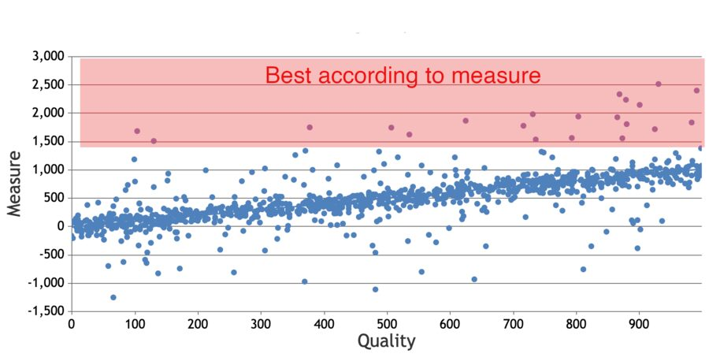
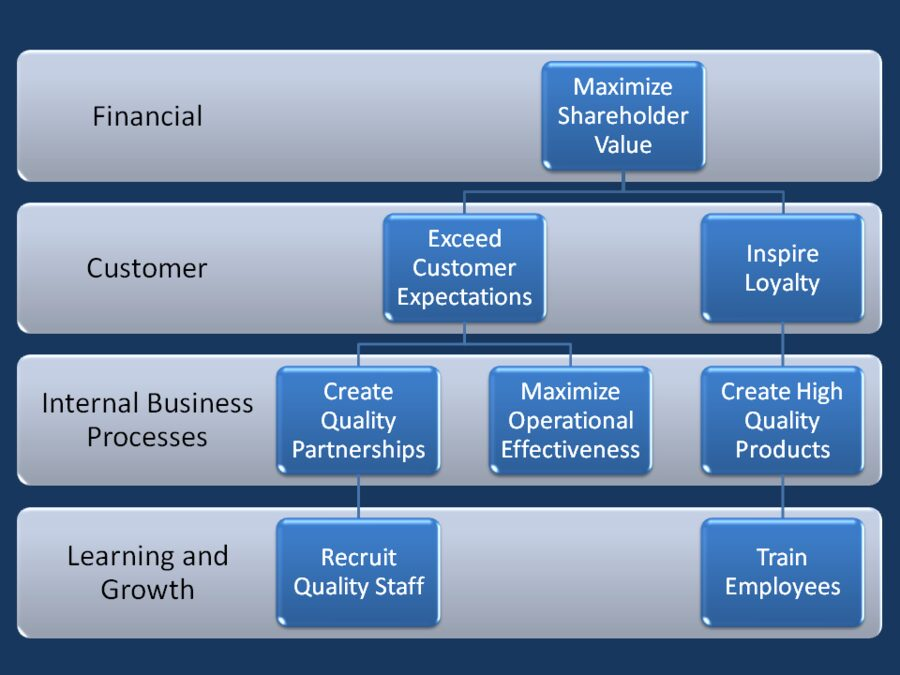
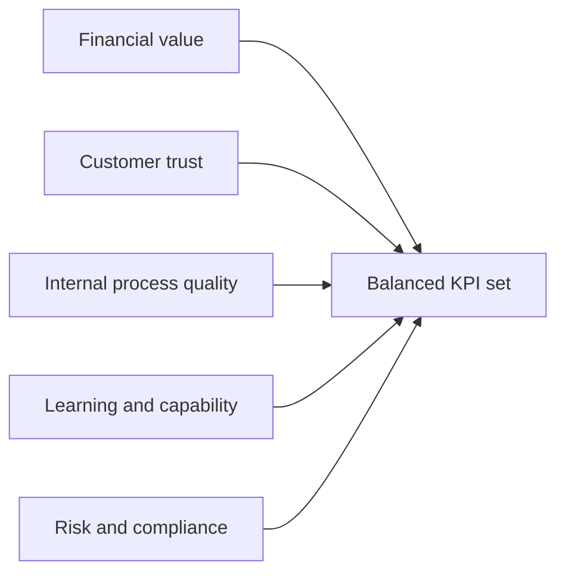

# Metric Quality and Governance

## Learning Objectives

By the end of this lesson, you should be able to:

- evaluate whether a metric is valid, reliable, useful, and actionable;
- identify metric gaming and Goodhart's law risks;
- design a review cadence and ownership model;
- connect metrics to decisions, experiments, and product governance;
- define governance for AI-system quality, human oversight, and risk metrics;
- explain why AI product metrics need guardrails beyond business performance.

## Metric Quality Criteria

Before a metric becomes a KPI or key result, test its quality.

| Criterion | Question |
| --- | --- |
| Validity | Does it measure the concept we care about? |
| Reliability | Would the same event be measured the same way tomorrow? |
| Sensitivity | Does it move when the product meaningfully changes? |
| Specificity | Can we interpret movement without too many confounders? |
| Actionability | Can the team respond when it changes? |
| Timeliness | Is the data available soon enough to guide decisions? |
| Trust | Do stakeholders understand and accept the definition? |

A metric can be technically correct and still not be management-ready if it is
too slow, too ambiguous, too gameable, or disconnected from action.

## Goodhart's Law and Metric Gaming

Goodhart's law is often summarized as:

> When a measure becomes a target, it can stop being a good measure.

_Source: Wikimedia Commons, ["Goodhart scatterplot.png"][goodhart-scatterplot]
by HonoreDB, CC0._

This is a warning, not a reason to avoid measurement. Targets change behavior.
The job of product management is to define metrics, targets, and guardrails
that steer behavior toward the intended outcome.

Examples:

| Target | Possible gaming risk | Guardrail |
| --- | --- | --- |
| Increase contact leads | Generate low-quality or duplicate leads | Qualified lead rate and complaint rate |
| Increase profile views | Show the same agents too often | Exposure fairness and agent diversity |
| Reduce support tickets | Make support harder to reach | Satisfaction after support and unresolved issue rate |
| Increase model automation | Remove useful human review | Override rate, audit findings, appeal success rate |

## Balanced AI Product Measurement

The balanced scorecard tradition is useful because it reminds teams not to
measure only financial outcomes. AI product managers also need customer,
process, learning, and risk perspectives.

_Source: Wikimedia Commons, ["Generic Strategy Map.png"][generic-strategy-map]
by Mrgs123, public domain._

For Imageboost, a balanced set might include:

| Perspective | Example measure |
| --- | --- |
| Financial value | Revenue from participating agents |
| Customer trust | Agent satisfaction with lead quality |
| AI-system quality | Relevant-agent display rate by market and agent segment |
| Internal process quality | Duplicate or invalid lead rate |
| Learning and capability | Percentage of KPI definitions with owners and baselines |
| Risk and compliance | Complaint rate, fairness review, privacy incidents |

## Governance: Who Reviews What?

Metrics only matter when they are reviewed by people who can act.

| Governance element | Definition |
| --- | --- |
| Owner | Person accountable for metric definition and interpretation |
| Reviewer | Forum or stakeholder group that reviews movement |
| Cadence | Weekly, monthly, pilot milestone, quarterly, or launch gate |
| Decision rule | What action follows green, amber, or red status |
| Change control | How definition changes are recorded |
| Audit trail | Where decisions and metric changes are documented |

## AI-System Governance Questions

AI-system metrics need governance because model or algorithm behavior can
change through data drift, new training data, ranking-rule updates, product
experiments, or changes in user behavior.

| Governance question | Why it matters |
| --- | --- |
| Who owns AI-system quality? | Product, data, and engineering may otherwise assume someone else is watching |
| Who can approve threshold changes? | Moving a threshold can change product behavior and stakeholder risk |
| How are human overrides reviewed? | Overrides reveal failure modes and training needs |
| Which segments are reviewed separately? | Average performance can hide weak markets or agent groups |
| What happens after drift is detected? | Detection is useful only if it triggers investigation or rollback |
| Where are model or rule changes documented? | Teams need an audit trail for interpreting metric movement |

## Measurement Cadence

Different metrics need different cadences.

| Cadence | Useful for |
| --- | --- |
| Daily | Operational health, incidents, data-pipeline failures |
| Weekly | Pilot performance, adoption signals, early behavior changes |
| Monthly | Business outcomes, segment comparisons, trend reliability |
| Quarterly | OKR review, strategy decisions, investment choices |
| Launch gate | Go, no-go, or scope-change decisions |

Do not review every metric in every meeting. Match cadence to decision speed.

## AI Product Measurement Guardrails

AI products often require extra guardrails because model behavior can drift,
perform unevenly across segments, or create hard-to-see risks.

Potential guardrails include:

- data quality and missingness;
- model accuracy by relevant segment;
- false positive and false negative rates;
- human override and escalation rates;
- user trust or satisfaction;
- privacy incidents or policy exceptions;
- cost per inference or operational cost;
- accessibility and fairness signals.

Human oversight metrics are not a sign that the AI product failed. They show
whether people can notice, correct, and learn from system behavior. A high
override rate may indicate a quality problem; a zero override rate may indicate
that users cannot challenge the system.

## Check Your Understanding

### Question 1

Why can a metric become less useful after it becomes a target?

Show solution

People and systems adapt to targets. If the target is narrow, teams may
optimize the number while damaging the real outcome. Guardrails,
counter-metrics, and qualitative review reduce this risk.

### Question 2

Why should KPI definitions have change control?

Show solution

If a formula, inclusion rule, or data source changes silently, trend
comparisons become unreliable. Change control preserves trust and helps teams
understand whether movement came from reality or measurement changes.

### Question 3

Why is a weekly review cadence not automatically better than a monthly cadence?

Show solution

Some metrics are noisy or slow-moving. Reviewing them too frequently can create
false urgency and overreaction. Cadence should match the speed at which the
metric can move meaningfully and the team can act.

### Question 4

Why should AI-system metric changes be documented alongside product changes?

Show solution

If a ranking rule, model version, threshold, label definition, or data source
changes, KPI movement may come from measurement or system changes rather than
real customer behavior. Documentation helps teams interpret trends and explain
decisions later.

## Key Takeaways

- A KPI system needs governance, not just formulas.
- Goodhart's law warns that targets change behavior.
- Counter-metrics and guardrails protect quality, trust, fairness, and cost.
- Review cadence should match decision cadence.
- AI product metrics need business, user, AI-system, human-oversight,
  operational, and risk perspectives.

## Further Reading

- [Goodhart's law](https://en.wikipedia.org/wiki/Goodhart%27s_law)
- [Balanced scorecard](https://en.wikipedia.org/wiki/Balanced_scorecard)
- [KPI.org: KPI Development](https://www.kpi.org/kpi-basics/kpi-development/)
- [Wikimedia Commons: Goodhart
  scatterplot](https://commons.wikimedia.org/wiki/File:Goodhart_scatterplot.png)
- [Wikimedia Commons: Generic Strategy
  Map](https://commons.wikimedia.org/wiki/File:Generic_Strategy_Map.png)

[goodhart-scatterplot]: https://commons.wikimedia.org/wiki/File:Goodhart_scatterplot.png
[generic-strategy-map]: https://commons.wikimedia.org/wiki/File:Generic_Strategy_Map.png
