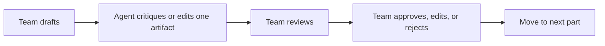
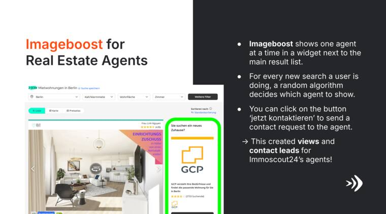
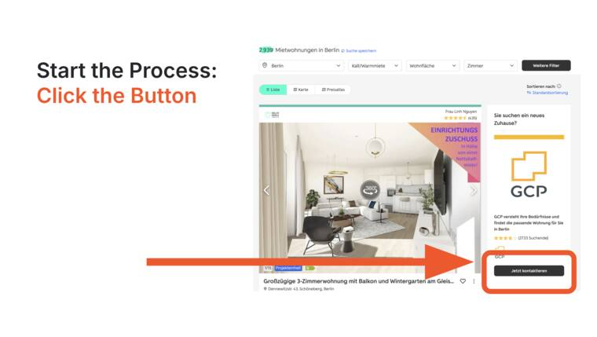
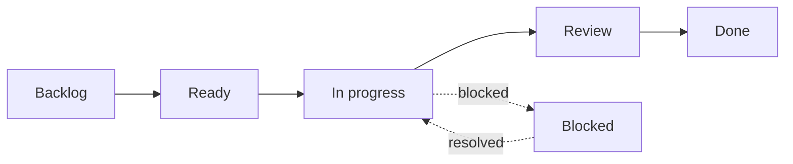

# Session Handout: KPI and OKR Workshop

This workshop turns KPI and OKR theory into a practical measurement-design
workflow. Your group will use GitHub Projects to track measurement work and
Claude Code, Codex, or a similar coding agent as an AI project-management
partner. The final deliverable is a static KPI and OKR dashboard prototype that
can be shown to stakeholders.

## Workshop Overview

Follow the numbered parts below as the source of truth. This overview is a
navigation map, not a second workflow.

| Step | Activity | Main output | Coding-agent role |
| --- | --- | --- | --- |
| Part 1 | Create the GitHub Project | Shared project board | None required |
| Part 2 | Create workshop issues | Measurement-design backlog | Draft or refine issue wording |
| Checkpoint 1 | Review the backlog | Approved backlog improvements | Critique missing work, unclear owners, and weak acceptance criteria |
| Part 3 | Define the business model and decision question | `business-model-and-decision-question.md` | Challenge whether the decision question is measurable |
| Part 4 | Write hypotheses | `hypotheses.md` | Test whether hypotheses connect product behavior to measurable outcomes |
| Checkpoint 2 | Challenge the hypotheses | Revised hypotheses and assumptions | Identify unsupported assumptions and missing risks |
| Part 5 | Build the metric inventory | `metric-inventory.md` | Suggest candidate business, user, AI-system, oversight, and risk metrics |
| Part 6 | Create KPI definition sheets | `kpi-definition-sheets.md` | Audit formulas, denominators, segments, and owners |
| Checkpoint 3 | Audit KPI definitions | Cleaner KPI definitions | Find vague, vanity, or non-actionable metrics |
| Part 7 | Add SMART targets and counter-metrics | Target and guardrail updates | Check whether targets are labeled as mock, assumed, or validated |
| Part 8 | Draft OKRs | `okrs.md` | Review whether objectives and key results are measurable and aligned |
| Checkpoint 4 | Test OKR quality | Revised OKRs | Identify weak key results, missing owners, and unrealistic scope |
| Part 9 | Define governance and review cadence | `governance-and-review-cadence.md` | Check decision rules, review forums, and open validation questions |
| Part 10 | Prepare the measurement briefing | `measurement-briefing.md` | Critique clarity, decision relevance, and stakeholder readiness |
| Checkpoint 5 | Rehearse the briefing | Improved briefing | Act as a skeptical stakeholder and ask hard questions |
| Part 11 | Build the static dashboard | `dashboard/` prototype | Generate HTML, CSS, JS, and dashboard documentation from approved artifacts |
| Checkpoint 6 | Review the dashboard | Human-approved dashboard | Check consistency, mock-data labels, and unsupported claims |
| Part 12 | Complete the AI collaboration log | `ai-collaboration-log.md` | Help summarize accepted, edited, and rejected suggestions |
| Part 13 | Validate the work | Validation notes and clean files | Run agreed validation commands and report issues |

Maintain `ai-collaboration-log.md` throughout the workshop, even though the
final cleanup happens in Part 12.

Use the official GitHub documentation as the reference for Project setup:

- [Quickstart for Projects](https://docs.github.com/en/issues/planning-and-tracking-with-projects/learning-about-projects/quickstart-for-projects)
- [Creating a project](https://docs.github.com/en/issues/planning-and-tracking-with-projects/creating-projects/creating-a-project)
- [Adding items to your project](https://docs.github.com/en/issues/planning-and-tracking-with-projects/managing-items-in-your-project/adding-items-to-your-project)
- [Customizing the board layout](https://docs.github.com/en/issues/planning-and-tracking-with-projects/customizing-views-in-your-project/customizing-the-board-layout)

## Working with a Coding Agent

Each group should use Claude Code, Codex, or a similar coding agent from the
local repository. The coding agent may read files, propose edits, create
workshop artifacts, build the dashboard, and run validation commands. The group
owns all final decisions.

Open the project with your coding agent using any available interface, such as
the VS Code extension, CLI, desktop application, or another graphical
interface.

Use this first prompt:

```text
Read this repository.

Summarize:
1. the workshop goal;
2. the Imageboost scenario;
3. the expected deliverables;
4. the files you may create or edit;
5. the rules you should follow.

Do not edit files yet.
```

### Coding Agent Rules

1. Draft ideas as a group before asking the coding agent to edit.
2. Ask the coding agent to propose a short plan before changing files.
3. Approve, edit, or reject the plan before the coding agent writes files.
4. Review every artifact as a group before moving to the next part.
5. Do not run the whole workshop as a single one-shot agent task.
6. Do not ask the coding agent to continue automatically across multiple parts.
7. Do not enter personal, confidential, or sensitive organizational data.
8. Do not let the coding agent invent validated baselines, targets, or business
   results.
9. Clearly label mock dashboard values as mock data.
10. Record important coding-agent contributions in `ai-collaboration-log.md`.

Use this workflow for each part:



Use this approval-gate prompt whenever the coding agent is about to edit:

```text
Before editing files, propose a short plan.

Include:
- files you will create or change;
- what each file will contain;
- assumptions you will not validate;
- validation commands you will run after editing.

Wait for our approval before changing files.
Do not continue to the next workshop part after this edit.
```

## Workshop Artifacts

Ask the coding agent to create these files as the workshop progresses:

| Artifact | Purpose |
| --- | --- |
| `measurement-backlog.md` | Tracks approved workshop issues and ownership |
| `business-model-and-decision-question.md` | Captures the product context and main decision |
| `hypotheses.md` | Records measurable product and AI-system hypotheses |
| `metric-inventory.md` | Lists candidate business, user, AI-system, oversight, and risk metrics |
| `kpi-definition-sheets.md` | Defines selected KPIs in reproducible detail |
| `okrs.md` | Captures product and team OKRs |
| `governance-and-review-cadence.md` | Defines owners, review forums, cadences, and decision rules |
| `measurement-briefing.md` | Summarizes the stakeholder-facing measurement strategy |
| `ai-collaboration-log.md` | Records accepted, edited, and rejected coding-agent suggestions |

Use this prompt to create the initial artifact files:

```text
Create the workshop artifact Markdown files listed in the handout.

Each file should contain:
- a short purpose statement;
- a blank working table or template;
- an "Open Questions" section;
- no invented answers.

Do not create the dashboard yet.
Do not fill in the artifacts yet.
Stop after creating the empty templates.
```

## Scenario: Imageboost for Real Estate Agents

You work as a product or data team supporting ImmoScout24, a real estate
platform. Consumers use the platform to find homes. Real estate agents and
private landlords pay to list and market properties. Agent revenue is therefore
important to the business model.

Imageboost is a promoted agent-profile widget placed next to the main property
search result list. It shows one agent at a time. For every new search, a
random allocation decides which agent to show. Consumers can click the contact
button to send a contact request.

For this workshop, treat random allocation as the current product behavior.
When the handout mentions AI-system metrics, model quality, ranking, or drift,
use those as possible future measurement concerns if Imageboost later moves
from random allocation to an AI-assisted ranking or targeting system. Do not
assume that a trained ML model already exists.



_Source: local course export, Imageboost case screenshot._

The product is expected to help agents:

- increase profile visibility;
- receive more contact leads;
- attract future property-listing clients;
- see enough value to continue paying for platform services.



_Source: local course export, Imageboost case screenshot._

## Part 1: Create the GitHub Project

Create or open the repository for your group. Then create a GitHub Project
named `KPI and OKR Workshop`.

Use a board view with these columns:



Create fields:

| Field | Type | Suggested values |
| --- | --- | --- |
| Workstream | Single select | Hypothesis, Metrics, KPI, OKR, Governance, Briefing, Dashboard, Process |
| Metric type | Single select | Activity, Output, Outcome, Impact, Counter-metric |
| Measurement layer | Single select | Business, User, AI-system, Oversight, Risk |
| Confidence | Single select | High, Medium, Low |
| Owner | Assignee | One responsible person |
| Needs validation | Checkbox | Checked when evidence is missing |

<details>
<summary>Show example setup</summary>

By the end of Part 1, the group should have:

- one Project board;
- columns for Backlog, Ready, In progress, Review, Blocked, and Done;
- fields for measurement design;
- all group members able to see and update the board.

</details>

## Part 2: Create Workshop Issues

Create issues for the workshop tasks and add them to the Project.

Use this issue structure:

```text
Title:

Purpose:

Done when:
- ...
- ...

Metric, artifact, or decision involved:

Validation needed:
```

Suggested issues:

| Issue | Workstream |
| --- | --- |
| Define the Imageboost decision question | Hypothesis |
| Map the business model and value drivers | Hypothesis |
| List candidate company metrics | Metrics |
| List candidate Imageboost product metrics | Metrics |
| List candidate AI-system quality metrics | Metrics |
| List human-oversight and escalation metrics | Metrics |
| Identify counter-metrics and risks | Metrics |
| Select primary KPIs | KPI |
| Write KPI definition sheets | KPI |
| Define SMART targets and baselines needed | KPI |
| Draft Imageboost OKRs | OKR |
| Review OKRs for task-based key results | OKR |
| Define review cadence and owners | Governance |
| Prepare measurement strategy briefing | Briefing |
| Build static KPI and OKR dashboard | Dashboard |
| Review dashboard assumptions and mock data labels | Dashboard |
| Maintain AI collaboration log | Process |

Copy the approved issue list into `measurement-backlog.md` before the first
coding-agent checkpoint. Keep one row per issue, including title, workstream,
owner, status, acceptance criteria, and validation needed.

### Coding Agent Checkpoint 1: Review the Backlog

Create the first backlog as a group. Then ask the coding agent to review it:

```text
Review our measurement-design backlog in measurement-backlog.md.

Identify:
- missing KPI or OKR design tasks;
- missing dashboard-building tasks;
- tasks that are too broad to finish;
- validation steps we forgot;
- acceptance criteria that are not observable;
- places where we might confuse initiatives with outcomes;
- missing AI-system, human-oversight, or risk measurement tasks.

Return findings and questions only. Do not edit files yet. Stop after this
review.
```

Discuss the response. If the group approves changes, ask the coding agent to
update `measurement-backlog.md` and record the decision in
`ai-collaboration-log.md`.

<details>
<summary>Show example issue</summary>

```text
Title: Write KPI definition sheets

Purpose:
Make selected KPIs reproducible and decision-ready.

Done when:
- Each KPI has a formula, denominator, inclusion and exclusion rules.
- Each KPI has an owner, cadence, segment, and counter-metric.
- Missing baseline data is marked as a validation question.

Metric, artifact, or decision involved:
Whether Imageboost is creating agent value without harming user trust.

Validation needed:
Confirm which lead-quality signals are available in the data.
```

</details>

## Part 3: Business Model and Decision Question

Summarize the business model and choose one decision question. Update
`business-model-and-decision-question.md`.

| Area | Notes |
| --- | --- |
| Paying customer |  |
| End user |  |
| Product promise |  |
| Business outcome |  |
| User or customer outcome |  |
| Main risk |  |
| AI-system behavior |  |
| Decision question |  |

<details>
<summary>Show example business model summary</summary>

| Area | Notes |
| --- | --- |
| Paying customer | Real estate agents and landlords who pay for visibility and leads |
| End user | People searching for properties |
| Product promise | Give agents more visibility and easier contact opportunities |
| Business outcome | Increase agent value, retention, and paid product revenue |
| User or customer outcome | Searchers can contact relevant agents more easily |
| Main risk | More visibility does not produce high-quality leads or feels unfair |
| AI-system behavior | Allocation or ranking decides which agent appears for each search |
| Decision question | Should ImmoScout24 invest further in Imageboost as a paid agent-growth product? |

</details>

## Part 4: Hypotheses

Write hypotheses before choosing KPIs. Update `hypotheses.md`.

| Hypothesis | Expected evidence | Risk or counter-hypothesis |
| --- | --- | --- |
|  |  |  |
|  |  |  |
|  |  |  |

### Coding Agent Checkpoint 2: Challenge the Hypotheses

Ask the coding agent to challenge the draft hypotheses:

```text
Review hypotheses.md.

Identify:
- hypotheses that are too vague;
- missing business or user assumptions;
- missing assumptions about allocation, ranking, model quality, or oversight;
- assumptions that require data validation;
- possible negative side effects;
- metrics that would prove or disprove each hypothesis.

Return critique and questions only. Do not edit the file yet. Stop after this
review.
```

After discussion, approve selected updates and ask the coding agent to apply
them. Review the updated `hypotheses.md` before moving to the metric
inventory.

<details>
<summary>Show example hypotheses</summary>

| Hypothesis | Expected evidence | Risk or counter-hypothesis |
| --- | --- | --- |
| Imageboost increases useful agent visibility | Participating agents receive more profile views per search impression | Views may concentrate among already-popular agents |
| Imageboost increases agent contact leads | Contact-button clicks and submitted leads increase versus baseline | Leads may be low quality or duplicated |
| Allocation or ranking shows relevant agents | Relevant-agent display rate reaches agreed threshold | The system may optimize clicks while reducing lead quality |
| Better visibility improves agent retention | Participating agents renew or upgrade at higher rates | Retention may not move within the pilot window |

</details>

## Part 5: Metric Inventory

List candidate metrics before deciding which are KPIs. Update
`metric-inventory.md`.

| Metric | Layer | Type | Why it matters | Possible denominator | Confidence |
| --- | --- | --- | --- | --- | --- |
|  | Business, user, AI-system, oversight, or risk | Activity, output, outcome, impact, or counter-metric |  |  |  |
|  | Business, user, AI-system, oversight, or risk | Activity, output, outcome, impact, or counter-metric |  |  |  |
|  | Business, user, AI-system, oversight, or risk | Activity, output, outcome, impact, or counter-metric |  |  |  |

<details>
<summary>Show example metric inventory</summary>

| Metric | Layer | Type | Why it matters | Possible denominator | Confidence |
| --- | --- | --- | --- | --- | --- |
| Widget impressions | User | Output | Shows exposure volume | Search result pages | High |
| Agent profile views | User | Outcome proxy | Measures visibility | Widget impressions or participating agents | Medium |
| Submitted contact leads | User | Outcome | Measures direct contact generation | Widget impressions or contact clicks | Medium |
| Qualified contact leads | Business | Outcome | Measures agent value | Submitted contact leads | Low until quality signal is confirmed |
| Relevant-agent display rate | AI-system | Outcome | Checks whether allocation or ranking matches search context | Widget impressions | Low until relevance labels are defined |
| Manual review or override rate | Oversight | Counter-metric | Shows whether people need to correct system behavior | Flagged leads or reviewed placements | Medium |
| Consumer complaint rate | Risk | Counter-metric | Protects trust | Widget impressions or active users | Medium |
| Exposure concentration | Risk | Counter-metric | Protects fairness among agents | Participating agents | Low until allocation data is confirmed |

</details>

## Part 6: KPI Definition Sheets

Select three to five KPIs. Define each one in `kpi-definition-sheets.md`.

| Field | KPI 1 | KPI 2 | KPI 3 |
| --- | --- | --- | --- |
| Name |  |  |  |
| Strategic goal |  |  |  |
| Formula |  |  |  |
| Unit |  |  |  |
| Measurement layer |  |  |  |
| AI-system behavior |  |  |  |
| Population |  |  |  |
| Exclusions |  |  |  |
| Segment |  |  |  |
| Baseline needed |  |  |  |
| Target |  |  |  |
| Cadence |  |  |  |
| Owner |  |  |  |
| Counter-metric |  |  |  |

### Coding Agent Checkpoint 3: Audit KPI Definitions

Ask the coding agent to audit the KPI definition sheets:

```text
Review kpi-definition-sheets.md.

Identify:
- unclear formulas;
- missing denominators;
- missing exclusions;
- targets that lack baselines;
- KPIs that are actually activity metrics;
- missing AI-system behavior or oversight assumptions;
- missing segment, fairness, or drift checks;
- missing counter-metrics;
- assumptions that require data or stakeholder validation.

Return findings and questions only. Do not edit the file yet. Stop after this
review.
```

After the group approves changes, ask the coding agent to update the file and
log the decision. Review the updated `kpi-definition-sheets.md` before moving
to SMART targets.

<details>
<summary>Show example KPI definition</summary>

| Field | Example |
| --- | --- |
| Name | Qualified Imageboost lead conversion rate |
| Strategic goal | Make Imageboost a trusted growth channel for agents |
| Formula | Qualified Imageboost contact leads divided by Imageboost widget impressions |
| Unit | Percentage |
| Measurement layer | User outcome and business value |
| AI-system behavior | Allocation or ranking affects who receives impressions and lead opportunities |
| Population | Participating agents in the pilot market |
| Exclusions | Internal traffic, duplicate leads, test accounts, spam leads |
| Segment | Agent type, market, device, lead channel |
| Baseline needed | Current conversion rate for comparable non-Imageboost profile placements |
| Target | Increase versus baseline by agreed pilot target |
| Cadence | Weekly during pilot, monthly after launch |
| Owner | Product lead with data analyst support |
| Counter-metric | Consumer complaint rate and agent dissatisfaction with lead quality |

</details>

## Part 7: SMART Targets and Counter-Metrics

Rewrite each KPI target using SMART criteria. Add the results to
`kpi-definition-sheets.md`.

| KPI | SMART target | Counter-metric | AI or risk red-line threshold |
| --- | --- | --- | --- |
|  |  |  |  |
|  |  |  |  |
|  |  |  |  |

<details>
<summary>Show example SMART target</summary>

| KPI | SMART target | Counter-metric | AI or risk red-line threshold |
| --- | --- | --- | --- |
| Qualified Imageboost lead conversion rate | Increase qualified lead conversion for participating Berlin rental agents by an agreed percentage versus pilot baseline within the pilot period | Consumer complaint rate and exposure concentration | Stop rollout expansion if complaint rate exceeds the agreed threshold or exposure concentration becomes unacceptable |
| Relevant-agent display rate | Reach an agreed relevance threshold for displayed agents in the pilot market before expanding ranking logic | Qualified lead quality and manual override rate | Pause algorithm changes if relevance drops or manual overrides rise above threshold |

The target still needs a real baseline and threshold. Do not invent those
numbers without data or stakeholder agreement.

</details>

## Part 8: OKRs

Draft one product OKR and one supporting team OKR in `okrs.md`.

| Level | Objective | Business or user KR | AI-system KR | Guardrail KR | Initiatives |
| --- | --- | --- | --- | --- | --- |
| Product |  |  |  |  |  |
| Team |  |  |  |  |  |

### Coding Agent Checkpoint 4: Test OKR Quality

Ask the coding agent to critique the OKRs:

```text
Review okrs.md.

Identify:
- objectives that are too vague or task-based;
- key results that are actually initiatives;
- missing baselines, targets, or counter-metrics;
- missing AI-system quality, oversight, or guardrail key results;
- key results that do not align with the product strategy;
- wording that would cause disagreement in a review meeting.

Return critique and questions only. Do not edit the file yet. Stop after this
review.
```

<details>
<summary>Show example OKR</summary>

| Level | Objective | Business or user KR | AI-system KR | Guardrail KR | Initiatives |
| --- | --- | --- | --- | --- | --- |
| Product | Make Imageboost a trusted acquisition channel for agents | Increase qualified contact-lead conversion versus baseline | Reach agreed relevant-agent display threshold for allocation or ranking | Keep complaint, support-ticket, and exposure-concentration measures below agreed guardrails | Widget copy test, agent reporting, allocation review |

</details>

## Part 9: Governance and Review Cadence

Define how the measurement system will be reviewed in
`governance-and-review-cadence.md`.

| Metric or OKR | Owner | Cadence | Review forum | Decision rule | Open validation question |
| --- | --- | --- | --- | --- | --- |
|  |  |  |  |  |  |
|  |  |  |  |  |  |
|  |  |  |  |  |  |

<details>
<summary>Show example governance row</summary>

| Metric or OKR | Owner | Cadence | Review forum | Decision rule | Open validation question |
| --- | --- | --- | --- | --- | --- |
| Qualified Imageboost lead conversion rate | Product lead | Weekly during pilot | Product, data, sales, and customer support pilot review | Continue if conversion improves and guardrails stay within threshold; pause expansion if quality drops | What signal best identifies a qualified lead? |
| Relevant-agent display rate | Data or product analyst | Weekly during pilot and after ranking changes | Product, data, and sales review | Investigate allocation logic if relevance or segment performance drops | Who provides relevance labels or review judgments? |

</details>

## Part 10: Measurement Strategy Briefing

Prepare a concise briefing for product leadership in
`measurement-briefing.md`.

```text
Product goal:

Decision question:

Primary KPIs:

AI-system and oversight metrics:

Counter-metrics:

OKR:

Review cadence:

Open validation questions:

Recommendation:
```

### Coding Agent Checkpoint 5: Rehearse the Briefing

Ask the coding agent to act as a skeptical product or business stakeholder:

```text
Review measurement-briefing.md as a skeptical product leader.

Ask five difficult questions about KPI definitions, baselines, targets,
AI-system metrics, oversight metrics, counter-metrics, OKR quality, and
decision rules. Identify unsupported claims and missing validation steps.

Do not edit the file yet. Stop after this
review.
```

Revise only after discussing the critique as a group.

<details>
<summary>Show example briefing summary</summary>

```text
Product goal:
Make Imageboost a trusted acquisition channel for agents.

Decision question:
Should we invest further in Imageboost as a paid agent-growth product?

Primary KPIs:
Qualified lead conversion rate, profile visibility per participating agent,
agent retention or renewal signal.

AI-system and oversight metrics:
Relevant-agent display rate, exposure distribution by agent segment, manual
review or override rate for questionable leads.

Counter-metrics:
Consumer complaint rate, duplicate or invalid lead rate, exposure concentration
among participating agents.

OKR:
Make Imageboost a trusted acquisition channel for agents, measured by lead
conversion, visibility, and guardrail performance.

Review cadence:
Weekly during pilot, monthly after launch.

Open validation questions:
Define qualified lead signal, confirm baseline, set complaint threshold.

Recommendation:
Run a controlled pilot with explicit guardrails before scaling placement.
```

</details>

## Part 11: Build the Static Dashboard

After the group approves the Markdown artifacts, ask the coding agent to build a
static dashboard prototype. The dashboard should be suitable for presenting to
product leadership, but it must clearly distinguish mock data from validated
evidence.

The coding agent should create:

```text
dashboard/
├── index.html
├── styles.css
├── data.js
└── README.md
```

The required files are `dashboard/index.html`, `dashboard/styles.css`,
`dashboard/data.js`, and `dashboard/README.md`.

Use this prompt:

```text
Create a static dashboard in a dashboard/ folder using HTML, CSS, and
JavaScript.

Use our approved workshop artifacts:
- business-model-and-decision-question.md
- hypotheses.md
- metric-inventory.md
- kpi-definition-sheets.md
- okrs.md
- governance-and-review-cadence.md
- measurement-briefing.md
- ai-collaboration-log.md

The dashboard should include:
1. executive summary;
2. OKR scorecard;
3. KPI cards grouped by business, user, AI-system, oversight, and risk metrics;
4. metric definition table;
5. assumptions and validation questions;
6. decision recommendation.

Use mock pilot data only where needed.
Clearly label all mock values as mock data.
Do not invent validated baselines, real targets, or real business results.
Keep the dashboard professional, readable, and suitable for presentation.
Stop after creating the dashboard files. Do not revise the measurement
artifacts unless the group asks you to do that separately.
```

Dashboard requirements:

| Section | Must show |
| --- | --- |
| Executive summary | Product goal, decision question, recommendation, confidence |
| OKR scorecard | Objective, key results, status, owner, confidence |
| KPI cards | Business, user, AI-system, oversight, and risk metrics |
| Metric definitions | Formula, denominator, population, exclusions, cadence, owner |
| Assumptions | Mock values, missing baselines, validation questions |
| Decision brief | Recommendation, trade-offs, next steps |

### Coding Agent Checkpoint 6: Review the Dashboard

Ask the coding agent to review the dashboard before presenting it:

```text
Review the dashboard and supporting artifacts.

Check whether:
- every mock value is clearly labeled as mock data;
- no baseline, target, or business result is presented as validated unless the
  artifact says it is validated;
- business, user, AI-system, oversight, and risk metrics are all represented;
- the OKR scorecard uses outcomes rather than tasks;
- the decision recommendation is supported by the stated evidence;
- the dashboard can be opened locally without build tools.

Return findings by severity. Do not edit files yet. Stop after this
review.
```

After the group approves fixes, ask the coding agent to update the dashboard.
Review the updated dashboard in a browser before preparing the final
presentation.

## Part 12: AI Collaboration Log

Document important coding-agent interactions in `ai-collaboration-log.md`.
Record decisions, not full chat transcripts.

| Activity | Coding-agent contribution | Assumption or risk found | Team decision | Reason |
| --- | --- | --- | --- | --- |
|  |  |  | Accepted, edited, or rejected |  |
|  |  |  | Accepted, edited, or rejected |  |
|  |  |  | Accepted, edited, or rejected |  |

<details>
<summary>Show example AI collaboration log</summary>

| Activity | Coding-agent contribution | Assumption or risk found | Team decision | Reason |
| --- | --- | --- | --- | --- |
| KPI audit | Flagged missing denominator for lead count | Lead count could rise only because impressions rose | Accepted | Changed KPI to qualified lead conversion rate |
| OKR review | Said "launch dashboard" was an initiative | The wording measured shipping, not value | Accepted | Moved dashboard to initiatives |
| Dashboard build | Added mock status values to KPI cards | Mock data could be mistaken for pilot results | Edited | Kept the values but labeled every card as mock data |
| Governance review | Suggested daily review of all KPIs | Daily review would create noise for lagging metrics | Rejected | Weekly pilot review better matches decision cadence |

</details>

## Part 13: Validate the Work

Ask the coding agent to run validation before the final presentation:

```text
Run these validation commands:

rumdl check --config 'global.disable = ["MD033"]' .
git diff --check

Then summarize:
1. changed files;
2. validation results;
3. dashboard files created;
4. mock values and assumptions still unresolved;
5. decisions the team must make manually.

Do not make additional edits unless the group approves a separate fix plan.
```

If validation fails, review the errors as a group and approve only the fixes
that preserve the workshop decisions.

## Final Deliverables

By the end of the workshop, your group should have:

- a GitHub Projects board with measurement-design issues;
- structured Markdown artifacts for backlog, business model, hypotheses,
  metric inventory, KPI definitions, OKRs, governance, briefing, and AI
  collaboration log;
- a metric inventory covering business, user, AI-system, oversight, and risk
  metrics;
- three to five KPI definition sheets;
- SMART targets and counter-metrics;
- one product OKR and one supporting team OKR;
- a governance and review-cadence table;
- a measurement strategy briefing;
- a static dashboard prototype in `dashboard/`;
- a dashboard `README.md` explaining how to open it and which data is mock;
- a coding-agent validation summary;
- an AI collaboration log showing accepted, edited, and rejected suggestions.
