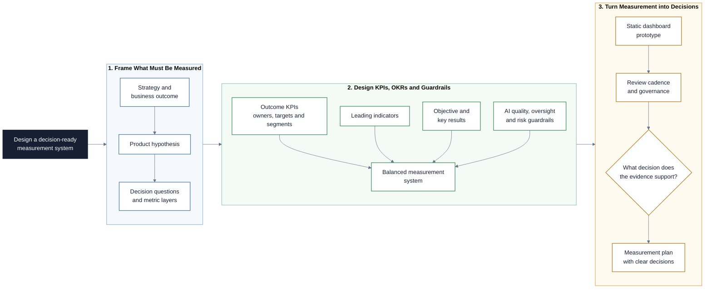

# KPI and OKR Design

This repository is a Markdown-based learning path for defining useful
measurement systems in AI product work. Participants learn how to move from
business goals to hypotheses, KPIs, OKRs, AI-system quality metrics,
human-oversight metrics, risk guardrails, review cadences, and decision-ready
reporting.

## Project at a Glance

The project translates strategy into a balanced measurement system that teams
can use to make decisions without losing sight of risk or user value.



## Learning Objectives

By the end of this repository, you should be able to:

- Explain the difference between metrics, KPIs, OKRs, targets, and initiatives.
- Translate product strategy into measurable hypotheses and decision questions.
- Design a balanced AI product measurement stack across business value, user
  value, AI-system quality, human oversight, and risk guardrails.
- Design KPIs with clear definitions, owners, targets, segments, and review
  cadence.
- Write SMART KPI targets without confusing activity, output, and outcome.
- Use OKRs to connect ambitious objectives to measurable key results.
- Identify vanity metrics, proxy metrics, counter-metrics, and metric gaming
  risks.
- Use Claude Code, Codex, or a similar coding agent to challenge assumptions,
  improve KPI definitions, test OKRs, build a static dashboard prototype, and
  validate workshop artifacts while retaining human decision ownership.
- Use GitHub Projects to track measurement design work and open validation
  questions.

## Learning Path

The modules build on each other in order.

| File / Folder | Description |
|---|---|
| [**01 - Measurement Foundations**](01-measurement-foundations.md) | Understand metrics, KPIs, OKRs, leading and lagging indicators, and the AI product measurement stack. |
| [**02 - KPI Design**](02-kpi-design.md) | Design high-quality KPIs across business, user, AI-system, oversight, and risk layers. |
| [**03 - OKR Design and Alignment**](03-okr-design-and-alignment.md) | Write OKRs that connect product value, AI-system quality, guardrails, initiatives, and strategy. |
| [**04 - Metric Quality and Governance**](04-metric-quality-and-governance.md) | Review metric quality, avoid gaming, define governance, and connect measurement to decision cadence. |
| [**05 - Session Handout**](05-session-handout.md) | Run the practical workshop using GitHub Projects, a coding agent, the Imageboost scenario, and a static dashboard prototype. |

### Additional Folders and Files

| File / Folder | Description |
|---|---|
| [**assets**](assets/) | Local images used in the lesson files and handout. |

## Setup

> [!NOTE]
> Throughout these steps, text in angle brackets like `<repo-name>` is a
> placeholder. Replace it including the `< >` brackets with your own value.
> For example, `cd <repo-name>` becomes `cd aipm-kpi-okr`.

### 1. Create the Repository from the Template

Click **Use this template** on GitHub.

When creating the repository:

- Set yourself as the **Owner**
- Choose a repository name
- Disable **Include all branches**
- Click **Create repository**

> [!IMPORTANT]
> If you are working in pairs or groups, only one person should complete this
> step.

---

### 2. Add Collaborators (Pairs/Groups Only)

If working with teammates:

1. Open the repository on GitHub
2. Go to **Settings -> Collaborators**
3. Add your teammates as collaborators
4. Share the repository link with your team

Teammates should accept the invitation before continuing.

---

### 3. Clone the Repository

Copy the SSH URL from the **Code** button on GitHub, then run:

```bash
git clone <copied-ssh-url>
```

The copied SSH URL will look like:
`git@github.com:<your-username>/<repo-name>.git`.

---

### 4. Move into the Project Folder

No Python environment is required for this repository.

```bash
cd <repo-name>
```

---

### 5. Open the Lesson Files

Open `README.md` and follow the lesson files in numerical order. The files are
plain Markdown and can be read directly on GitHub or in a local editor.

## References & Further Reading

- [**KPI.org: KPI Basics**](https://www.kpi.org/kpi-basics/):
  Practical overview of KPIs as critical, quantifiable measures of progress.
- [**KPI.org: KPI Development**](https://www.kpi.org/kpi-basics/kpi-development/):
  Measure-Perform-Review-Adapt approach for building KPI systems.
- [**Google re:Work: Set goals with OKRs**](https://rework.withgoogle.com/intl/en/guides/set-goals-with-okrs):
  Google-oriented guide to setting objectives and key results.
- [**What Matters: What is an OKR?**](https://www.whatmatters.com/faqs/okr-meaning-definition-example):
  Definition and examples of objectives and key results.
- [**SMART criteria**](https://en.wikipedia.org/wiki/SMART_criteria):
  Orientation on SMART goal-setting and its historical roots.
- [**Objectives and key results**](https://en.wikipedia.org/wiki/Objectives_and_key_results):
  Orientation on OKR history and structure.
